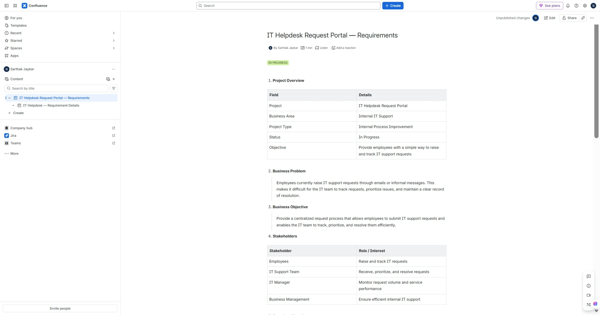

# Confluence Mini-Project — IT Helpdesk Request Portal

## Business scenario

Employees are raising IT support requests through emails or informal messages. This makes it harder for the support team to maintain consistent request information and for employees to understand how requests are handled.

## Objective

Create a centralised documentation concept for an IT Helpdesk Request Portal, defining the business context and organising the requirements that would guide a structured request process.

## BA artefacts documented

- Project overview, business problem, and objective
- Stakeholder identification
- Functional and non-functional requirements
- User story and acceptance criteria
- Requirements tables
- Confluence status macro
- Parent/child page hierarchy

## Evidence

The screenshots below show the structure and key content created in Confluence.

| Evidence | What it demonstrates |
|---|---|
| [Project overview](01_project_overview.jpeg) | Project context, business problem/objective, and stakeholders |
| [Requirements](02_requirements.jpeg) | Functional and non-functional requirements |
| [User story and acceptance criteria](03_user_story_acceptance.jpeg) | Requirement elaboration into a testable user need |
| [Page hierarchy](04_page_hierarchy.jpeg) | Organisation of parent and child documentation pages |

### Screenshot preview

## Business Analyst relevance

This exercise demonstrates how Confluence can be used to maintain project knowledge and communicate requirements in a structured, accessible format. It focuses on documentation quality and traceability rather than software implementation.

## Interview summary

“I created a small IT Helpdesk Request Portal documentation exercise in Confluence. I documented the business context and stakeholders, captured functional and non-functional requirements, and elaborated a user story with acceptance criteria. I also organised the content using Confluence tables, a status macro, and a parent/child page hierarchy.”

## Author

[Sarthak Jaykar — GitHub](https://github.com/sarthak-jaykar) · [LinkedIn](https://www.linkedin.com/in/sarthak-jaykar/)
