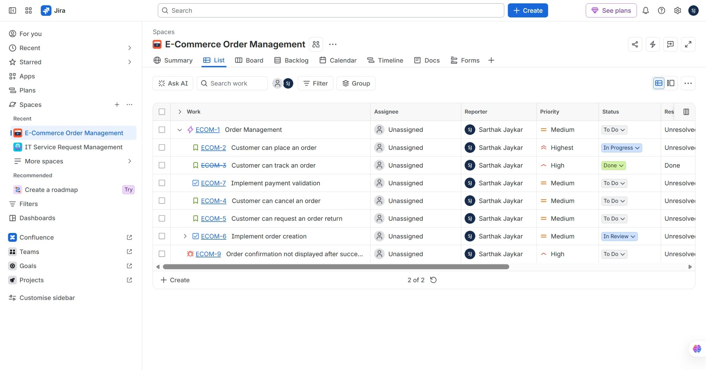

# Jira Mini-Project — E-Commerce Order Management

## Business scenario

An e-commerce business wants to support a more organised order-management journey, covering order placement, tracking, cancellation, and returns.

## Objective

Practise translating a small set of business needs into structured Jira work items and tracking them through a basic Agile workflow.

## Requirements represented

1. Customers can place an order.
2. Customers can track an order.
3. Customers can cancel an order.
4. Customers can request an order return.

## Jira work completed

- Created a Jira Scrum project.
- Created an **Order Management** epic.
- Created four user stories with descriptions and acceptance criteria.
- Applied priorities and story points.
- Added tasks and a sub-task.
- Created and managed a one-week sprint.
- Used the workflow **To Do → In Progress → Review → Done**.
- Created and tracked a bug.
- Used basic JQL to filter issues.

## Evidence

| Evidence | What it demonstrates |
|---|---|
| [Epic and user stories](01-epic-and-user-stories.jpeg) | Epic structure and story organisation |
| [Acceptance criteria](02-user-story-acceptance-criteria.jpeg) | Requirement detail and testable acceptance conditions |
| [Sprint workflow](03-active-sprint-workflow.jpeg) | Sprint and issue-state tracking |
| [JQL and bug filter](04-jql-bug-filter.jpeg) | Defect tracking and issue filtering |

### Screenshot preview

## Business Analyst relevance

Jira helps connect requirements with delivery activity. This exercise demonstrates the practical steps of organising an epic and backlog, writing user stories and acceptance criteria, prioritising work, supporting sprint execution, and tracking defects.

## Interview summary

“I created a standalone Jira exercise around e-commerce order management. I translated four customer needs into user stories with acceptance criteria, organised them under an epic, prioritised the work, and practised sprint and workflow management. I also created a bug and used basic JQL to filter issues.”

## Project status

Completed — standalone Jira tool-practice exercise.

## Author

[Sarthak Jaykar — GitHub](https://github.com/sarthak-jaykar) · [LinkedIn](https://www.linkedin.com/in/sarthak-jaykar/)
