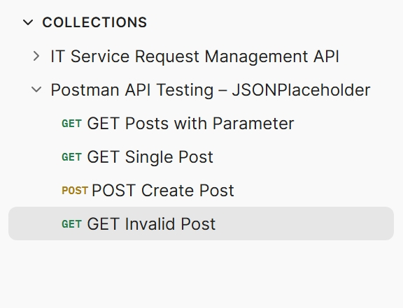

# Postman Mini-Project — JSONPlaceholder API Testing

## Objective

Practise basic REST API request and response checks using JSONPlaceholder, a public test API. The exercise builds API and integration awareness relevant to a Business Analyst working with system requirements and technical teams.

## API used

**JSONPlaceholder** — public mock REST API for testing and learning.

## Test scenarios

| Scenario | What was practised | Observed response |
|---|---|---|
| GET posts | GET request with `_limit` query parameter | 200 OK |
| GET single post | Path parameter and response validation | 200 OK |
| POST create post | JSON request body and Content-Type header | 201 Created |
| GET invalid post | Negative/error scenario | 404 Not Found |

## Validations practised

- HTTP status-code checks
- Required response-field checks
- Response content/data checks
- Generated ID checks
- Negative/error response checks

## Evidence

The evidence files are stored directly in this project folder (there is no separate `screenshots/` directory).

| Evidence | What it demonstrates |
|---|---|
| [Collection overview](01-collection-overview.jpeg) | Organisation of the API requests |
| [POST request and validation](02-post-request-validation.jpeg) | Request payload and response checks |
| [Negative test and validation](03-negative-test-validation.jpeg) | Handling of an invalid resource request |

### Screenshot preview

## Business Analyst relevance

APIs support data exchange and integration between systems. A Business Analyst may need to understand endpoint purpose, request parameters, payload fields, expected responses, and error scenarios when documenting integration requirements or discussing system behaviour with technical teams.

This exercise demonstrates basic API testing awareness; it is not a production integration or a complete API test strategy.

## Interview summary

“I used Postman with the JSONPlaceholder public test API to practise GET and POST requests, query and path parameters, JSON request bodies, headers, and response validation. I also tested an invalid resource to review a negative scenario and its 404 response.”

## Author

[Sarthak Jaykar — GitHub](https://github.com/sarthak-jaykar) · [LinkedIn](https://www.linkedin.com/in/sarthak-jaykar/)
